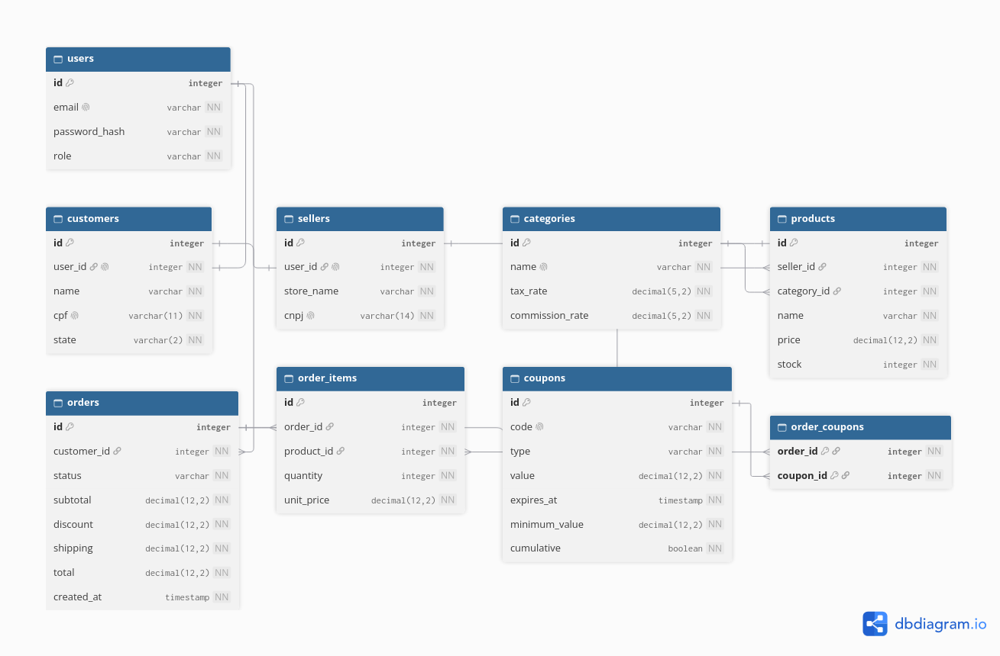

## Objetivo

Este documento explica algumas das decisões tomadas durante a construção do DER (Diagrama Entidade-Relacionamento), para facilitar o entendimento da estrutura do banco de dados pelos integrantes do squad.

A modelagem foi desenvolvida com base no código herdado do Módulo 1 e nos requisitos da rubrica do Módulo 2.

## Diagrama Entidade-Relacionamento (DER)

O diagrama abaixo apresenta as nove tabelas do banco de dados,
seus atributos e respectivos relacionamentos.

## Convenções adotadas

- Nomes de tabelas e campos em inglês.
- Nomes de tabelas no plural.
- Utilização de `snake_case`, como em `user_id` e `unit_price`.

## Entendendo as tabelas

### Users

Responsável por armazenar as informações de acesso ao sistema, como e-mail, hash da senha e papel do usuário.

Um usuário pode ser um cliente, vendedor ou administrador.

### Customers

Armazena as informações específicas dos clientes, como nome, CPF e estado.

Mas por que separar `users` de `customers`? Não são a mesma pessoa?

Um cliente também é um usuário, mas nem todo usuário é um cliente. Ele pode ser um vendedor ou administrador.

Por isso, separar as informações de acesso ao sistema das informações específicas de cada tipo de usuário.

Também optamos por armazenar a UF do cliente, pois o código herdado utiliza essa informação para identificar a região e calcular o frete.

### Sellers

Segue a mesma lógica de `customers`, mas essa tabela armazena informações específicas dos vendedores, como o nome da loja e o CNPJ.

Tanto o cliente quanto o vendedor possuem uma conta na tabela `users`.

### Categories

Responsável por armazenar as categorias dos produtos, juntamente com suas taxas de tributos e comissões.

Por exemplo, a categoria de eletrônicos possui uma alíquota de 12% e uma comissão de 8%.

Se essas informações fossem armazenadas diretamente em cada produto, teríamos dados repetidos.

Criando uma tabela específica para categorias, conseguimos centralizar essas informações. Caso seja necessário alterar uma taxa, basta atualizar o registro da categoria, em vez de alterar todos os produtos individualmente.

### Products

Armazena os produtos disponíveis no marketplace, incluindo nome, preço atual, quantidade em estoque, vendedor e categoria.

Um vendedor pode possuir vários produtos, assim como uma categoria pode conter vários produtos.

Optamos por armazenar o estoque diretamente nessa tabela, pois cada produto possui apenas uma quantidade disponível. Portanto, não precisamos criar uma tabela separada para o estoque neste projeto.

### Orders

Essa tabela é responsável por armazenar as informações dos pedidos de cada cliente, como subtotal, descontos, frete, valor total e data de criação.

O pedido possui três status, conforme determina a rubrica:

- `aberto`: o pedido ainda pode ser modificado.
- `confirmado`: a compra foi confirmada e os produtos são retirados do estoque.
- `cancelado`: a compra foi cancelada.

Um cliente pode realizar vários pedidos, mas cada pedido pertence a apenas um cliente. Portanto, temos um relacionamento 1:N (um para muitos).

Mas aqui temos um pequeno problema: um pedido pode conter vários produtos, e um mesmo produto pode aparecer em vários pedidos.

Isso caracteriza um relacionamento N:N (muitos para muitos). Para representar esse relacionamento no banco de dados relacional, precisamos criar uma tabela intermediária.

#### Order_items

É uma tabela intermediária que conecta os pedidos aos produtos.

Sua responsabilidade é informar quais produtos fazem parte de cada pedido, a quantidade comprada e o preço unitário no momento da compra.

Por exemplo:

| Pedido | Produto | Quantidade |
| ------ | ------- | ---------- |
| 1      | Mouse   | 1          |
| 1      | Livro   | 1          |
| 2      | Mouse   | 2          |

Dessa forma, conseguimos identificar quais produtos pertencem a cada pedido.

Uma das decisões mais importantes dessa tabela é armazenar o preço histórico.

Por exemplo, se um cliente comprou um mouse por R$ 120,00 e posteriormente o produto passou a custar R$ 150,00, o pedido antigo deve continuar registrando o valor de R$ 120,00.

Por isso, o preço atual do produto e o preço do item comprado são armazenados separadamente.

### Coupons

Armazena os cupons de desconto disponíveis no marketplace.

Cada cupom possui um código, tipo de desconto, valor, validade, valor mínimo de compra e uma indicação de que pode ou não ser combinado com outros cupons.

Existem três tipos de cupons, conforme a rubrica:

- **Percentual:** desconto em porcentagem.
- **Fixo:** desconto em reais.
- **Frete:** elimina o valor do frete.

Os cupons são aplicados ao pedido inteiro, e não individualmente aos produtos.

#### Order_coupons

É uma tabela intermediária responsável por identificar quais cupons foram utilizados em cada pedido.

Como um pedido pode utilizar até dois cupons e um mesmo cupom pode ser utilizado em diferentes pedidos, temos outro relacionamento N:N, desta vez entre `orders` e `coupons`.

Por isso, precisamos de uma tabela intermediária para registrar essas associações.

A combinação do identificador do pedido com o identificador do cupom também impede que o mesmo cupom seja registrado duas vezes no mesmo pedido.

## Resumo dos relacionamentos

| Tabelas               | Relacionamento                  |
| --------------------- | ------------------------------- |
| Users e Customers     | 1:1                             |
| Users e Sellers       | 1:1                             |
| Customers e Orders    | 1:N                             |
| Sellers e Products    | 1:N                             |
| Categories e Products | 1:N                             |
| Orders e Products     | N:N, através de `order_items`   |
| Orders e Coupons      | N:N, através de `order_coupons` |

## Normalização

A normalização serve para organizar os dados, evitar repetições desnecessárias e reduzir inconsistências.

Um exemplo disso é a separação entre produtos e categorias. Não precisamos repetir o nome, a alíquota e a comissão da categoria em cada produto, pois essas informações estão armazenadas em `categories`.

Já o armazenamento do preço histórico não é uma repetição desnecessária, pois o preço atual do produto e o preço praticado no momento da compra representam informações diferentes.

## O que armazenamos e o que calculamos?

O subtotal, os descontos, o frete e o valor total são calculados pelas regras de negócio do sistema.

A proposta é armazenar esses resultados para preservar os valores financeiros dos pedidos confirmados, garantindo que futuras alterações não modifiquem o valor original da compra.

Isso exige que a aplicação mantenha esses valores consistentes.

## Algumas restrições utilizadas

- **PK (Primary Key):** identifica um registro de maneira única.
- **FK (Foreign Key):** conecta um registro a outra tabela.
- **Unique:** impede valores duplicados.
- **Not Null:** torna um campo obrigatório.
- **Default:** define um valor padrão.

Essas restrições ajudam a evitar problemas, como contas com e-mails duplicados ou produtos associados a vendedores inexistentes.

## Pontos pendentes para discussão

Antes da implementação definitiva, precisamos alinhar algumas decisões com o squad:

- Padronização dos nomes das tabelas, campos e contratos da API.
- Restrições para impedir valores e quantidades inválidos.
- Preservação do histórico de tributos e comissões.
- Tratamento da exclusão de produtos que já fazem parte de pedidos.

A modelagem apresentada é uma proposta e poderá ser atualizada conforme as decisões da equipe.
